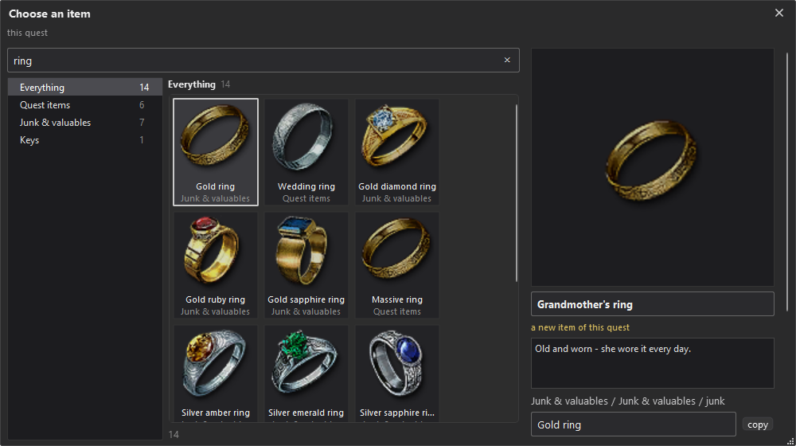
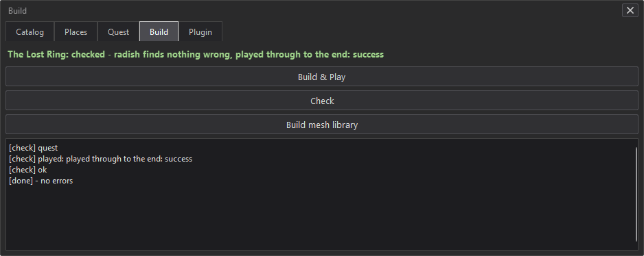

# Your first quest

A villager lost her ring to bandits. The player has to talk to her, find the chest with the ring, bring it back and
get paid.

## 1. A project

Press **F8** in the game's main menu. On **Projects**, press **New project**, name it `The Lost Ring`, choose
**Quest** and press **Create and open ingame**. The project opens in a session of its own in Velen. Saving is
deactivated during a session, so your save files don't get confused.

Go to an open area where the quest should take place.

## 2. The editor

- **F8** switches between editing and playing. While you edit, the game stands still.
- Hold the right mouse button to look around, **W A S D** to fly, **Space** up, **X** down. Hold **F** and turn the
  mouse wheel to adjust the fly speed.
- **Select** moves, turns, duplicates (**Ctrl+D**) and deletes (**Del**) what you placed.
- **Asset Browser** has every NPC, creature, object and item of the game.
- **Project** opens the panel: **Places**, **Quest** and **Build**.

Every change is saved right away. **Ctrl+Z** undoes.

## 3. How a quest is built

**Project** > **Quest**. The name at the top is the quest's name in the journal. Below it is the quest graph: steps
from **QUEST STARTS** down, each line leading to the next step.

**QUEST STARTS** sets the journal section, the journal entry and when the quest starts: **Starts automatically**,
**With a game quest ...** or **After a game quest ...**. The last two open the story map with every quest of the game.

The blocks on the left:

- **Goal**: something the player has to do. The journal shows it as an objective.
- **Action**: something the game does (a reward, a weather change, an NPC turning hostile).
- **Choice**: branches (either / or, at random, or by a condition).
- **Meanwhile**: a track alongside the story.
- **Chapter**: a heading for a part of a long quest.
- **End**: completed or failed.

A block goes after the selected step, or between two steps when you drag it onto their line. The **▾** beside a
step's kind chooses what it is: a Goal can be Talk, Go to, Collect, Kill and more.

A step's **card** opens below the graph. What is missing is red (`Missing: character`). An output that leads nowhere
says `output not wired`.

## 4. Step 1: talk to the villager

Add a **Goal** and set it to **Talk**.

**choose who** > **Create a new person** opens the Asset Browser on NPCs. Search `townswoman` and open **Rich
Townswoman**: a folder with her 9 looks. A green speech mark means the look can speak in a dialogue, a red one that
it stays silent. Choose a look with a green mark, press **Place** and set her down.

**starts** decides how the dialogue begins:

| starts | the dialogue begins |
|---|---|
| On interaction (E) | when the player talks to her |
| When the player is near | when the player comes close |
| Overheard (the player listens) | as the player walks past; the player only listens |
| NPC calls out | she calls a line when the player comes close, then waits |
| Immediately (cutscene) | right away, as a cutscene |

Choose **NPC calls out** and type what she calls: `Witcher! Over here!`

**Edit dialogue** opens the dialogue editor, with its own blocks:

- **Line**: something a character says. Click the name to change the speaker.
- **Choice**: options the player picks from.
- **If**: a branch by a condition.

Each option ends one way:

| ending | what happens |
|---|---|
| end: continue | the Talk is done, the quest goes on |
| end: repeatable | the dialogue ends, the player can come back later |
| end: fail quest | the quest fails |
| back to choice | the choice is shown again (for questions) |

Add her line: `Witcher! Bandits took my very expensive ring. They hid it somewhere in the woods.` Then a **Choice** with two
options: `I'll find it.` with **end: continue**, `I'm too rich for this.` with **end: repeatable**. **Back** in the upper left returns to the quest.

A line can also have a gesture, a mood, a camera, a voice of the game or a recording of your own.

## 5. Step 2: the hiding place

Add a **Goal** set to **Go to**. **+ Set the spot** puts down a flag. The ring around it is where the goal counts as
reached; **more** on the card changes its size, the map marker and a time of day.

Type the objective: `Find the bandits' hiding place`.

## 6. Step 3: the ring

Add a **Goal** set to **Collect**.

1. **what** > **+ item** opens every item of the game. Search `ring`, pick one and rename it to `Cheap fake ring`.
   A renamed item is a new item of this quest. **Choose item**.

   

2. **where**: **in a container**, **a person carries it** or **not placed** (the player finds or buys it
   elsewhere). Choose **in a container**.
3. **in** > **Create a new container**: place a chest near the flag.
4. **Random loot** **Off**: only the ring is inside.

## 7. Step 4: bring it back

Add another **Goal** > **Talk** and choose her under **who**.

In her dialogue, add a line (`Did you find it?`) and a Choice with the option `Why is this a cheap ring? Ugh here you go.` Under its **Effects**
choose **Player gives an item** and the ring. That dialogue option only shows while the player carries the ring. Give it **end:
continue**, and add a second option `Not yet.` with **end: repeatable**.

Then add an **Action** > **Reward**: 50 crowns and 50 experience. Last, add an **End** and drag the Reward's output
onto it.

## 8. Test it

**Build** > **Check** plays the quest through with a stand-in player and says where a branch gets stuck.

**Build & Play** puts the quest into the session. It starts fresh, and you stand where you stood.
Open the journal: **The Lost Ring** is there.

To change something, press **F8**, change it and use Build & Play again. **Play from here** in a step's **···** menu
starts the quest at that step, with the items of the steps before.

## 9. Share it

**Build** > **Export quest file** makes `Documents\Conjunction\exports\<quest name>\` with:

- a zip for Nexus and mod managers
- the quest file (`.w3q`) for Conjunction's **Library**
- a placeholder text for the quest's Nexus page

A quest with things from other mods lists them on the Build tab. Players who lack one are told where to get it, see
[content-creators.md](content-creators.md).

## Next

Every block and kind of step: [quest-graph.md](quest-graph.md).

- an option with a branch of its own: drag its output into the empty graph
- a later step that depends on that decision: **Choice** > **If**
- enemies: **Goal** > **Kill**; a fight after a dialogue: **Action** > **Hostile**
- clues for the witcher senses: **Goal** > **Find clues**; an object to look at: **Examine**
- **Gwent** and **Fist fight** as goals, with an output for a lost game
- a different outcome each time: **Choice** > **At random**
- something alongside the story (a timer, remarks of a companion): **Meanwhile**
- a long quest: **Chapter** headings; **Jump to** at the top of the Quest tab
- NPCs who act: a line's **Gesture** > **Find another ...**
- another region: **Action** > **Travel**
- a cellar or a cave of your own: **Places** > **Hide area**, see [world-changes.md](world-changes.md)
- a place that stays in the world, like a house: **New project** > **Place mod**
